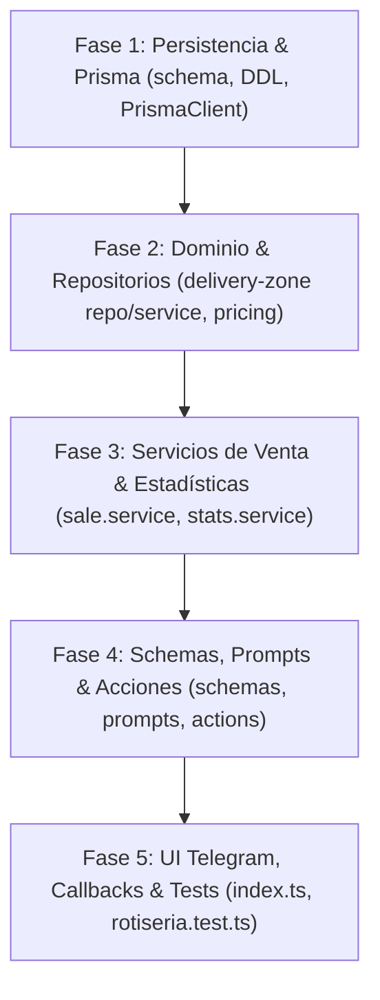

# Technical Implementation Plan: Soporte de Zonas de Envío y Flete (`rotiseria`)

**Referencia:** [`docs/SPEC-rotiseria-delivery.md`](file:///c:/Users/Luciano/Documents/Bot-platform/docs/SPEC-rotiseria-delivery.md)  
**Status:** Ready to Implement

---

## 1. Arquitectura y Slices Verticales

Dividimos el desarrollo en 5 fases secuenciales verificables:

---

## 2. Desglose por Fases

### Fase 1: Persistencia y Base de Datos
- **Objetivo:** Modelo `RotiseriaDeliveryZone` y extensión de `RotiseriaSale` en `prisma/schema.prisma`.
- **Archivos:**
  - `prisma/schema.prisma`
  - `prisma/migrations/20261010150000_add_rotiseria_delivery_zones/migration.sql`
- **Verificación:** `pnpm prisma generate` y verificación de tipos generados.

### Fase 2: Repositorios y Dominio de Delivery
- **Objetivo:** Repositorio y Servicio de zonas de entrega + cálculo en `pricing.ts`.
- **Archivos:**
  - `src/templates/rotiseria/types.ts`
  - `src/templates/rotiseria/persistence/delivery-zone.repo.ts`
  - `src/templates/rotiseria/domain/delivery-zone.service.ts`
  - `src/templates/rotiseria/domain/pricing.ts`
- **Verificación:** Tests unitarios de matching flexible de zonas/barrios y discriminación de flete $0 vs null en pricing.

### Fase 3: Integración con Ventas y Estadísticas Segregadas
- **Objetivo:** Almacenamiento de flete en ventas y reporte segregado de comida vs cadetería.
- **Archivos:**
  - `src/templates/rotiseria/persistence/sale.repo.ts`
  - `src/templates/rotiseria/domain/sale.service.ts`
  - `src/templates/rotiseria/domain/stats.service.ts`
  - `src/templates/rotiseria/format.ts`
- **Verificación:** Comprobación de que `foodTotal` no se contamina con `deliveryFee` en resúmenes diarios ni estadísticas.

### Fase 4: Schemas Zod, Prompts de IA y Acciones
- **Objetivo:** Acciones `/envios`, `configurar_envios_lote`, y soporte de zonas en `registrar_venta`.
- **Archivos:**
  - `src/templates/rotiseria/schemas.ts`
  - `src/templates/rotiseria/prompts.ts`
  - `src/templates/rotiseria/actions.ts`
- **Verificación:** Ejecución de acciones con inputs estructurados y validaciones Zod.

### Fase 5: Conversación en Telegram, Callbacks y Quality Gates
- **Objetivo:** Menú interactivo, asignación de flete manual para zonas dudosas, tests completos y gates.
- **Archivos:**
  - `src/templates/rotiseria/index.ts`
  - `tests/rotiseria.test.ts`
  - `MEMORY.md`
- **Verificación:** `pnpm typecheck`, `pnpm test`, `pnpm build`.
